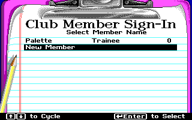
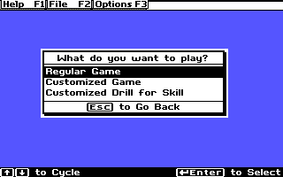

# Outnumbered Native for macOS

A native Apple Silicon reimplementation of **Super Solvers Outnumbered**, written
in Swift with Cocoa. This is an active reconstruction project, not the finished
game. It uses translated original data and native game logic; no DOS emulator,
original DOS executable, or compiled DOS drawing routine runs inside the app.

## Current verified milestone: 0.28

All ten activity families and 3,200 question cases render natively. Recovered
movement, encounters, calculator, decoder, ending/bonuses, lifetime progression
and native saves are connected. Player menus now expose ordinary/custom games,
unfinished-game continuation, separate custom settings and Drill for Skill.
Music and master Sound have independent source-derived gates. Original new-user
guidance now responds to room, challenge, decoder, clock and input events.
Practice sets contain5/10/15/20 problems, retain attempts/correct counters and
leave an unfinished adventure unchanged. Replay retains mutated decoder pools.

**924 integration checks pass.** The app ZIP passes strict signature verification
and the same checks after extraction; the packaged source is independently
rebuilt with Apple tools. See [the verification record](docs/verification-0.28.json)
and [settings/practice recovery](docs/menu-practice-recovery.md) and
[score-table recovery](docs/score-history-recovery.md) and
[music/message recovery](docs/music-messages-recovery.md) and
[practice presentation](docs/practice-presentation-recovery.md) and
[adventure Telly presentation](docs/drill-presentation-recovery.md) and
[timed charts/sliders/cassettes](docs/activity-timing-recovery.md) and
[prize/spinner/music/equipment effects](docs/activity-effects-recovery.md) and
[television static](docs/television-effect-recovery.md) and
[original opening](docs/opening-presentation-recovery.md) and
[member sign-in and File menus](docs/signin-file-recovery.md) and
[keyboard polling](docs/keyboard-recovery.md) and
[EGA palette recovery](docs/palette-recovery.md).

Settings use accessible native macOS controls with recovered original rules.
Remaining original confirmation/settings presentation, modifier/alternate input,
encounter/ending refinements, palette/audio calibration and a fresh complete
playthrough remain unfinished. See [the full plan](docs/PLAN.md),
[project context](PROJECT_CONTEXT.md) and [milestones](MILESTONES.md).
Headless and native-window checks are separate evidence; this is not the complete game.

## Build on an Apple Silicon Mac

Requires macOS12 or later and Apple's command-line developer tools. Run:

```sh
zsh build.sh
```

The verified app is packaged in `build/Outnumbered-Native-Development.zip`.
Extract it in a local folder and open `Outnumbered Native Development.app`.
The wrapper extracts the checked-in derived runtime data, then invokes the Swift
build script. Python, a DOS emulator and a downloaded runtime are not required
to build or play this version. The app has an ad-hoc development signature;
it is not Apple-notarized.

F1 opens the original eight-topic help book with22 pages and four illustrations.
Enter advances the title and two original instruction pages, then the station entrance opens Club Member Sign-In. Select a member or New Member with arrows and Enter. The play panel has Regular Game, Customized Game and Customized Drill for Skill; Escape returns to sign-in. F2 opens File during play; F3 opens options.
Practice Enter starts another set; Esc/F2 preserves the suspended adventure.

In the app, Command-R opens the recorded rainfall question (answer 644).
Command-D opens the recorded drill, and Command-4 opens a Junior question
selected by the recovered startup rules (answer 165). Command-5 runs the local
video's ending checkpoint: Game 11,680 / Total 64,275, then Enter and Yes replay
into a new game. Reference checkpoints are isolated from player saves.

In normal play, a correct decoder choice runs the ending and saves the winning
result once. A wrong hideout choice or midnight loses without adding lifetime
points. Replay retains earned rank and resets game progress.


The score screenshot uses isolated display fixtures.






These two images are headless render fixtures; native-window observations are recorded separately in docs/gui-observations-0.26.json.


The practice capture is a functional observation, not proof of pixel parity.
See the recovery report for the unresolved repeated-capture text discrepancy.

## Inputs and preservation

The original DOS ZIP and downloaded gameplay MKV are read-only local inputs
and are not committed. `source/runtime-data.zip` contains derived native runtime
images, fonts, PCM and generated question data. Their provenance and limitations
are documented in the recovery notes. This private repository does not grant
rights to original game artwork, sounds, names or other third-party content.

The local MKV supersedes the original YouTube reference. Screenshots at
https://www.myabandonware.com/game/super-solvers-outnumbered-115 remain a visual
reference. No video download or original executable is required at runtime.

## Milestone updates

The user authorized pushing an update after every verified milestone. Each
milestone commit records the resulting behavior, checks and remaining gaps.
Unverified work is not presented as a completed milestone. See
[the update workflow](docs/MILESTONE-WORKFLOW.md).


Milestone0.11 adds original lifetime/high-game score screens and the source
top-ten insertion rules. Individual winning games retain their pre-award rank;
ties stay behind existing equals, and ties with tenth do not qualify. History
and lifetime commit atomically with result recovery. Existing files without
history remain readable; historical games are not invented from lifetime totals.
353 native checks pass. Command7/8 open the score screens; Enter/Esc returns.
Arrow keys page lifetime rows when native profiles exceed the DOS ten slots.
Music/new-user options, original practice animations, full File/sign-in UI,
transitions/collision, timed effects and complete playthrough remain unfinished.
See score-history-recovery.md for original evidence and native adaptations.


Milestone0.12 connects independent Music and master Sound controls, opening
theme requests and all18 original new-user message texts. Native session flags
preserve original unseen/queued/acknowledged states; Yes resets them, No preserves
them. Source-derived room, challenge, collision, decoder, energy, clock and idle
input hooks display guidance through accessible macOS dialogs with readable key
names. Practice message state remains separate from the suspended adventure.
382 native checks pass. Native dialog pixels, exact settled-actor timing and
opening credits remain presentation gaps; see music-messages-recovery.md.
The complete-game goal remains active, with original practice animations,
transitions/collisions, timed effects, palette/sound calibration, ending refinements
and full natural-playthrough verification still required.


Milestone0.13 restores the original Drill for Skill introduction and all three
result animations (108 recovered sprite commands), their sounds and the
sound-completion wait before the original Enter-to-continue prompt. The source
counter panel/digits,120-tick problem-count boundary and independent practice
timer replace the previous native footer. Running counters survive another set;
practice still awards no adventure rewards and never writes its suspended save.
469 native checks pass, including both imperfect animation/sound selections,
exact two-draw result RNG consumption, timer/counter boundaries, sound waiting,
repeated sets, visible questions and deterministic animation repainting.
Keyboard-buffer/driver parity, opening/File presentation, transitions/collisions,
timed activities, palette/audio calibration, ending refinements and a full
natural adventure playthrough remain. See practice-presentation-recovery.md.


Previous verification milestone: [0.14 ordinary win and restart](docs/ordinary-playthrough-0.14.md). At0.14, the application binary and469-check package remained version0.13;0.14 recorded additional ordinary native-window evidence.


Milestone0.15 implements staged room-door transitions and corrects elevator exit facing. See [transition recovery and limits](docs/door-elevator-transition-recovery.md) and [native-window observations](docs/gui-observations-0.15.json). Full elevator animation and other remaining full-game fidelity work are still pending.


Milestone0.16 adds the original staged elevators: approach/shrunken/front poses, four mirrored-panel frames with source23IRQ waits, eight vertical bands with source23IRQ waits and correct direction, one-time travel sound/destination changes, final side-specific facing, input lockout and persistent travel progress. All563 native checks pass. Final native-window trips verified both left-side directions and corrected the viewport padding seam; right-side origins and save/resume have headless coverage. Existing resources remain unchanged. Camera/boundary edge cases, auxiliary actor stepping during synchronous transitions, collision/knockback/occlusion, timed activities, opening/File/sign-in, queued inputs and remaining ending/palette/audio fidelity still prevent complete-game status. See elevator-transition-recovery.md and gui-observations-0.16.json.


Milestone0.17 restores Telly, projectile and LiveWire updates during room/elevator pose and panel loops. Spawning stays disabled as in1559(0), but absent-enemy RNG draws and active motion continue. The elevator cleanup update is included; vertical scroll bands do not step actors. Saved per-frame cursors prevent repeated updates after restore, and older cursorless saves skip completed frames without replaying past RNG. Alignment preserves the initial facing until the original force-right pose. All582 native checks pass, including exact absent-enemy draw totals, active Telly motion, projectile/LiveWire updates, timer batching equivalence and legacy resume. A naturally spawned Telly/projectile advanced during a normal native-window News entrance; room exit and elevator travel also completed. Detailed camera/bounds, collision/knockback/occlusion, machine eye animation, timed activities, opening/File/sign-in, queued input and remaining ending/palette/audio fidelity keep the complete-game goal active.


Milestone0.18 restores original camera-before-actor ordering and signed movement for walking, horizontal jumps and door/elevator alignment. The recovered asymmetric floor-edge predicates preserve a two-unit jump camera overshoot; original screen bounds replace the former global clamp. New transition saves retain the recovered scrolled return viewport; older in-progress transitions retain their previous frame positions. All610 native checks pass, including floor traversals, edge arithmetic, transition alignment and enemy context ordering. Native-window walking and a Cartoon Room approach/entry/return verify the scrolled aligned viewport. Blocked-walk impact/recovery, collision/knockback/occlusion, machine eye animation, timed activities, opening/File/sign-in, queued input and remaining ending/palette/audio fidelity keep the complete-game goal active.


Milestone0.19 replaces the coarse player pose counter with persisted original walk/flip/impact/knockback/recovery states. Blocked walks play nine impact and nine recovery frames; collisions use the recovered word,200IRQ wait, reaction and one-time penalty. LiveWire uses its original ROOM reaction sprites. Telly and projectiles now draw after the player, matching actor slots. All675 native checks pass, including every reaction row, exact completion sounds, all projectile/facing combinations, partial-flash/reaction resume, frozen actors/RNG and opaque foreground pixels. Ordinary native-window play showed a boundary impact, a natural type25 projectile hit followed by recovery, and a vertical jump/landing. Impact-word timing and diagonal flips remain headless observations. Broader mask/encounter presentation, machine eye actor, timed activity effects/RNG, opening/File/sign-in, queued input, ending/palette/audio refinements and a fresh full playthrough keep the complete-game goal active.


Milestone0.20 restores the room ceiling security camera (correcting the earlier energy-machine-eye label): original panning row14, four-update holds, actor order, entry/exit lifecycle and retained timing state. Recharge now uses recovered scrolling alignment, raised player poses, continued enemy/projectile updates and exact per-frame RNG bookkeeping; the unpaced-copy display interval remains a documented native adaptation. Older in-progress actions retain their prior schedule. All713 checks pass. Local video shows the corresponding pan poses; ordinary native play separately showed a panning Cartoon camera and empty-machine interaction with scroll, moving Telly/projectile and unchanged energy9. Remaining encounter/capture presentation, timed activity effects/RNG, opening/File/sign-in, queued input, ending/palette/mask/audio refinements and a fresh full playthrough keep the complete-game goal active.


Milestone0.23 restores prize price/outline flashes and their original retry-based random consumption, spinner highlights, Great Eight music-header flashes and Equipment List header cycles. Native saves retain the initial random stream and applied checkpoint cursor; repainting cannot advance it, and future phases do not consume it early. Question/input appear only after the recovered waits.800 native checks pass, including1280 endpoint comparisons, exact54-draw prize fixture/next-draw validation, partial restore and prior0.22 compatibility. Native windows separately verify spinner/music/equipment answers and a normal new-game prize activity17→300points with Game Show clues. The TV static effect remains pending because its command23 aliases a bounded-range helper with unresolved caller arguments. Opening/File/sign-in, queued input, driver masks/palette/audio, ending refinements and a fresh complete playthrough still prevent complete-game status. See activity-effects-recovery.md.


Milestone0.24 restores the television-table noise introduction:60 paired XOR phases with original sound/waits and2580 random draws. Focused caller-stack recovery establishes the no-argument range bounds0..8512; the native effect preserves the EGA byte masks, including its same-byte crossing quirk.818 checks pass, covering320 static endpoints, independent coordinates/stream states, save/resume, input lockout and every byte alignment. Native windows verified the isolated168→300 checkpoint and a normal Equipment TV activity222→600 total/room clues. All nine activity families with timed drawing now have native schedules; the map needs no such intro. This does not establish complete campaign/pixel/audio identity. Opening/File/sign-in, queued input, remaining mask/palette/ending/audio refinements and a fresh full ordinary win remain required. See television-effect-recovery.md.

Command-T opens the isolated television-table checkpoint (answer168).


Milestone0.25 restores the three-page opening with24 original instruction lines, Enter-keycap prompts,12000IRQ page deadlines and24IRQ grey wipes, followed by40 original sprite/sound commands in three scripts (320/160/1080IRQ). The native compositor retains source restore references and callback copy bounds, locks input during the entrance and hands off to the existing player menu.848 checks pass, including timeout cycling, sound boundaries, ignored-key clock stability, pure repainting and suspended-game preservation. Native windows show title/objective/Telly pages, Escape/No, flight and station frames, completion and replay. Copied profile/session files remain byte-for-byte unchanged. Native F1/click/exit-dialog adaptations and broader palette/mask/audio limits are explicit. Original File/sign-in, general input buffering, remaining ending refinements and a fresh complete ordinary win remain required. See opening-presentation-recovery.md.


Milestone0.26 restores the original member clipboard and eight-slot name editor, the three-choice play panel and separate adventure/practice File menus. The source-derived rows, rank/lifetime columns, wrap navigation, XOR selection and caret timing replace the earlier eight-item native menu. Existing native player names/saves remain compatible. Removal is a named native adaptation: profiles move into a recoverable archive, and their unfinished sessions and high-game history remain intact. 877 native checks pass, including independent file preservation, archive/reload/restore, duplicate rejection, menu/pause navigation and pure rendering. Native confirmations/settings/restore controls, general BIOS buffering, remaining ending/rank/midnight/palette/mask/audio refinements and a fresh full ordinary playthrough still prevent complete-game status. See signin-file-recovery.md.

Ctrl-R on the sign-in list opens Remove Member. Native removal preserves the member and unfinished game in an archive; Game → Restore Removed Member restores it. Original ten-member creation limits apply to new original-style names; existing longer names and larger native member lists remain compatible.


Milestone0.27 adds recovered last-key world polling, deferred ordinary keys through synchronous gameplay actions, separately tracked held controls and original right-walking priority. Held Up/diagonal requests repeat after landing; Space follows first-make/repeat/release flags at game frames. Practice keeps early Enter through its result animation/sound wait, while new answer fields discard keys from preceding drawing/feedback. 911 checks pass, including input queue ordering/flush, deferred door delivery, physical movement across menus, release/priority/landing, editor lockout and queued practice continuation. Native focus loss clears input as a platform adaptation. BIOS buffer capacity/overflow, alternate modifier/keyboard-type handling, remaining dialog/ending input, palette/mask/audio refinements and a fresh complete ordinary adventure remain unverified; this is not the complete game. See keyboard-recovery.md.

Gameplay keys are polled on game frames. Hold movement keys and hold Space briefly to zap. F1/F2/Tab pressed during synchronous gameplay sequences wait until those sequences finish; later queued keys can supersede earlier ones. Keys during question drawing or drill feedback do not answer the next problem.


Milestone0.28 restores the original EGA palette swap (index0 blue, index1 black), retains all original bitmap indices through drawing, and applies the same palette to text and primitives. Source pen11h remains black for final prize prices; random pen0 remains blue. Black/white selection and TV XOR now preserve the low plane. Local MKV31/33/110s corroborates black member text, selected rows, menu footers and plot/background colors. 924 checks pass, including thirteen palette/index/RGBA/compositing checks. Full masks/occlusion, display/audio calibration, original dialogs/alternate input/endings and a fresh complete ordinary playthrough remain open. See palette-recovery.md.
