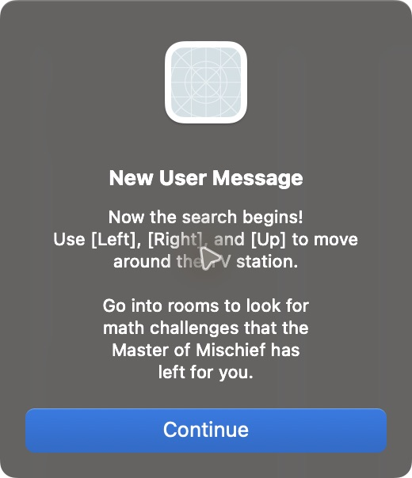
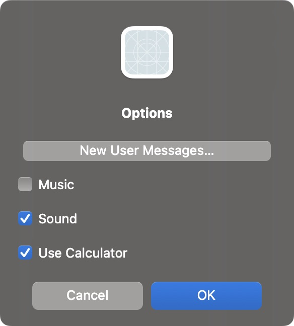
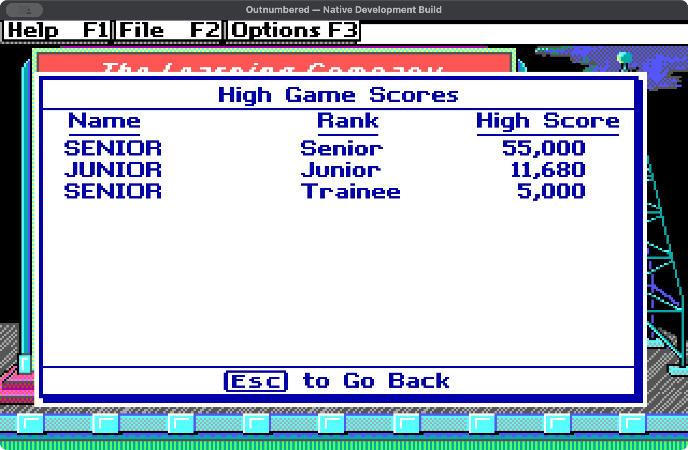
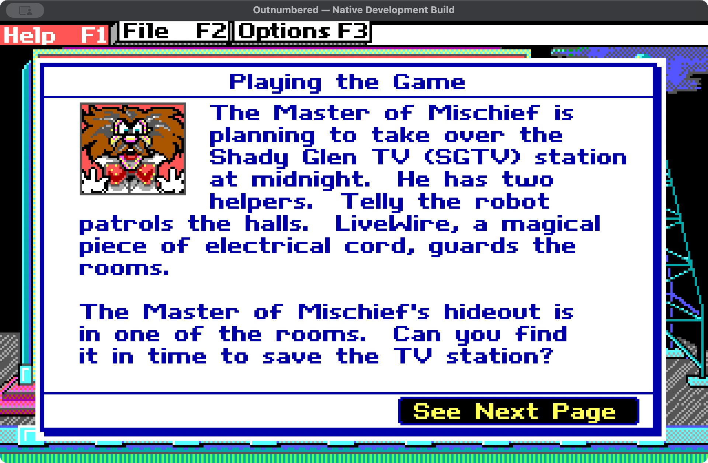
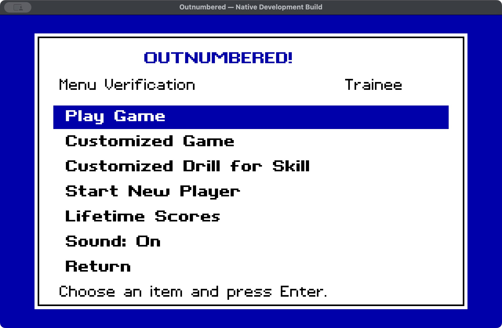
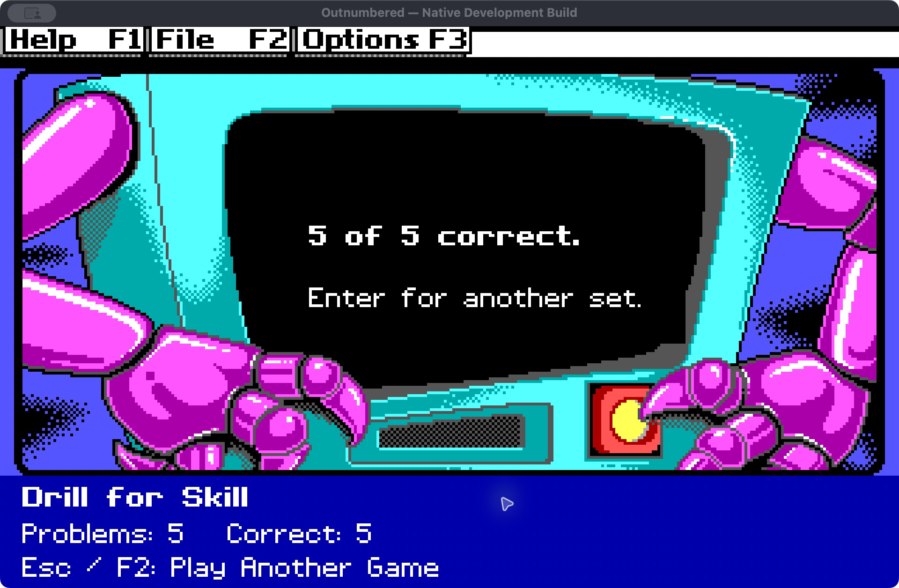

# Outnumbered Native for macOS

A native Apple Silicon reimplementation of **Super Solvers Outnumbered**, written
in Swift with Cocoa. This is an active reconstruction project, not the finished
game. It uses translated original data and native game logic; no DOS emulator,
original DOS executable, or compiled DOS drawing routine runs inside the app.

## Current verified milestone: 0.12

All ten activity families and 3,200 question cases render natively. Recovered
movement, encounters, calculator, decoder, ending/bonuses, lifetime progression
and native saves are connected. Player menus now expose ordinary/custom games,
unfinished-game continuation, separate custom settings and Drill for Skill.
Music and master Sound have independent source-derived gates. Original new-user
guidance now responds to room, challenge, decoder, clock and input events.
Practice sets contain5/10/15/20 problems, retain attempts/correct counters and
leave an unfinished adventure unchanged. Replay retains mutated decoder pools.

**382 integration checks pass.** The app ZIP passes strict signature verification
and the same checks after extraction; the packaged source is independently
rebuilt with Apple tools. See [the verification record](docs/verification-0.12.json)
and [settings/practice recovery](docs/menu-practice-recovery.md) and
[score-table recovery](docs/score-history-recovery.md) and
[music/message recovery](docs/music-messages-recovery.md).

Settings use accessible native macOS controls with recovered original rules.
Original opening/menu/practice animations,
detailed encounter/transition effects, palette and full-playthrough validation
remain unfinished. See [the full plan](docs/PLAN.md),
[project context](PROJECT_CONTEXT.md) and [milestones](MILESTONES.md).
Headless and native-window checks are separate evidence; this is not the complete game.

## Build on an Apple Silicon Mac

Requires macOS12 or later and Apple's command-line developer tools. Run:

```sh
zsh build.sh
```

The verified app is packaged in `build/Outnumbered-Native-Development.zip`.
Extract it in a local folder and open `Outnumbered Native Development.app`.
The wrapper extracts the checked-in derived runtime data, then invokes the Swift
build script. Python, a DOS emulator and a downloaded runtime are not required
to build or play this version. The app has an ad-hoc development signature;
it is not Apple-notarized.

F1 opens the original eight-topic help book with22 pages and four illustrations.
Title Return opens the player menu; F2 returns to it and F3 opens options.
Practice Enter starts another set; Esc/F2 preserves the suspended adventure.

In the app, Command-R opens the recorded rainfall question (answer 644).
Command-D opens the recorded drill, and Command-4 opens a Junior question
selected by the recovered startup rules (answer 165). Command-5 runs the local
video's ending checkpoint: Game 11,680 / Total 64,275, then Enter and Yes replay
into a new game. Reference checkpoints are isolated from player saves.

In normal play, a correct decoder choice runs the ending and saves the winning
result once. A wrong hideout choice or midnight loses without adding lifetime
points. Replay retains earned rank and resets game progress.







The score screenshot uses isolated display fixtures.







The practice capture is a functional observation, not proof of pixel parity.
See the recovery report for the unresolved repeated-capture text discrepancy.

## Inputs and preservation

The original DOS ZIP and downloaded gameplay MKV are read-only local inputs
and are not committed. `source/runtime-data.zip` contains derived native runtime
images, fonts, PCM and generated question data. Their provenance and limitations
are documented in the recovery notes. This private repository does not grant
rights to original game artwork, sounds, names or other third-party content.

The local MKV supersedes the original YouTube reference. Screenshots at
https://www.myabandonware.com/game/super-solvers-outnumbered-115 remain a visual
reference. No video download or original executable is required at runtime.

## Milestone updates

The user authorized pushing an update after every verified milestone. Each
milestone commit records the resulting behavior, checks and remaining gaps.
Unverified work is not presented as a completed milestone. See
[the update workflow](docs/MILESTONE-WORKFLOW.md).


Milestone0.11 adds original lifetime/high-game score screens and the source
top-ten insertion rules. Individual winning games retain their pre-award rank;
ties stay behind existing equals, and ties with tenth do not qualify. History
and lifetime commit atomically with result recovery. Existing files without
history remain readable; historical games are not invented from lifetime totals.
353 native checks pass. Command7/8 open the score screens; Enter/Esc returns.
Arrow keys page lifetime rows when native profiles exceed the DOS ten slots.
Music/new-user options, original practice animations, full File/sign-in UI,
transitions/collision, timed effects and complete playthrough remain unfinished.
See score-history-recovery.md for original evidence and native adaptations.


Milestone0.12 connects independent Music and master Sound controls, opening
theme requests and all18 original new-user message texts. Native session flags
preserve original unseen/queued/acknowledged states; Yes resets them, No preserves
them. Source-derived room, challenge, collision, decoder, energy, clock and idle
input hooks display guidance through accessible macOS dialogs with readable key
names. Practice message state remains separate from the suspended adventure.
382 native checks pass. Native dialog pixels, exact settled-actor timing and
opening credits remain presentation gaps; see music-messages-recovery.md.
The complete-game goal remains active, with original practice animations,
transitions/collisions, timed effects, palette/sound calibration, ending refinements
and full natural-playthrough verification still required.
