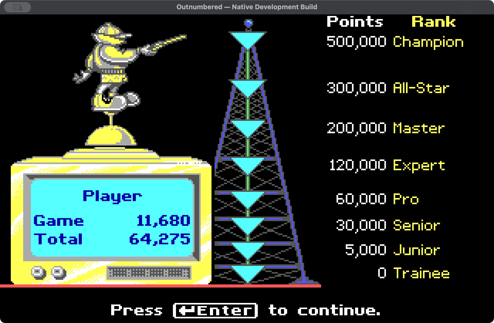

# Outnumbered Native for macOS

A native Apple Silicon reimplementation of **Super Solvers Outnumbered**, written
in Swift with Cocoa. This is an active reconstruction project, not the finished
game. It uses translated original data and native game logic; no DOS emulator,
original DOS executable, or compiled DOS drawing routine runs inside the app.

## Current verified milestone: 0.8

All ten activity families and 3,200 finite-domain question cases render natively.
Recovered question choices, decoder generation, movement, Telly drills, LiveWire,
recharge, calculator, clues and native saves are implemented. The original
scripted hideout reveal, progressive bonuses, win/loss results, lifetime points
and replay are now connected. **269 integration checks pass**, including a restart
during the tally and recovery from an interrupted result save without awarding
points twice.

The app ZIP passed strict signature verification and all 269 checks after
extraction. The packaged source was rebuilt with Apple tools and passed the
same checks. See [the verification record](docs/verification-0.8.json).

Original menus/options/help/notes/practice, detailed ending/transition effects,
collision presentation, palette and full-playthrough fidelity remain unfinished. See
[the full plan](docs/PLAN.md), [project context](PROJECT_CONTEXT.md), and
[milestone history](MILESTONES.md). Headless checks are separate from native-window
observations and do not establish a complete game.

## Build on an Apple Silicon Mac

Requires macOS12 or later and Apple's command-line developer tools. Run:

```sh
zsh build.sh
```

The verified app is packaged in `build/Outnumbered-Native-Development.zip`.
Extract it in a local folder and open `Outnumbered Native Development.app`.
The wrapper extracts the checked-in derived runtime data, then invokes the Swift
build script. Python, a DOS emulator and a downloaded runtime are not required
to build or play this version. The app has an ad-hoc development signature;
it is not Apple-notarized.

In the app, Command-R opens the recorded rainfall question (answer 644).
Command-D opens the recorded drill, and Command-4 opens a Junior question
selected by the recovered startup rules (answer 165). Command-5 runs the local
video's ending checkpoint: Game 11,680 / Total 64,275, then Enter and Yes replay
into a new game. Reference checkpoints are isolated from player saves.

In normal play, a correct decoder choice runs the ending and saves the winning
result once. A wrong hideout choice or midnight loses without adding lifetime
points. Replay retains earned rank and resets game progress.



## Inputs and preservation

The original DOS ZIP and downloaded gameplay MKV are read-only local inputs
and are not committed. `source/runtime-data.zip` contains derived native runtime
images, fonts, PCM and generated question data. Their provenance and limitations
are documented in the recovery notes. This private repository does not grant
rights to original game artwork, sounds, names or other third-party content.

The local MKV supersedes the original YouTube reference. Screenshots at
https://www.myabandonware.com/game/super-solvers-outnumbered-115 remain a visual
reference. No video download or original executable is required at runtime.

## Milestone updates

The user authorized pushing an update after every verified milestone. Each
milestone commit records the resulting behavior, checks and remaining gaps.
Unverified work is not presented as a completed milestone. See
[the update workflow](docs/MILESTONE-WORKFLOW.md).
